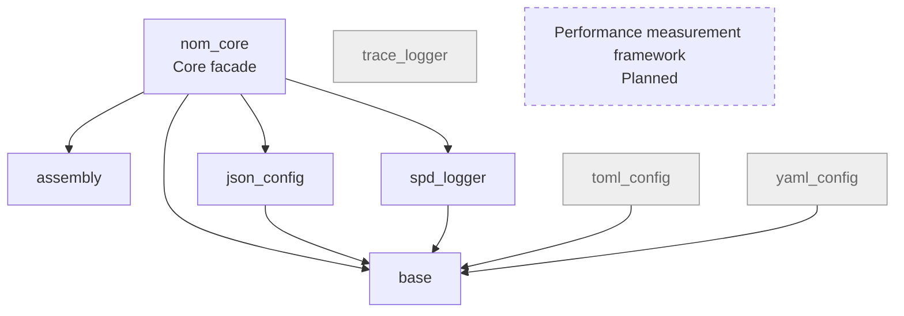
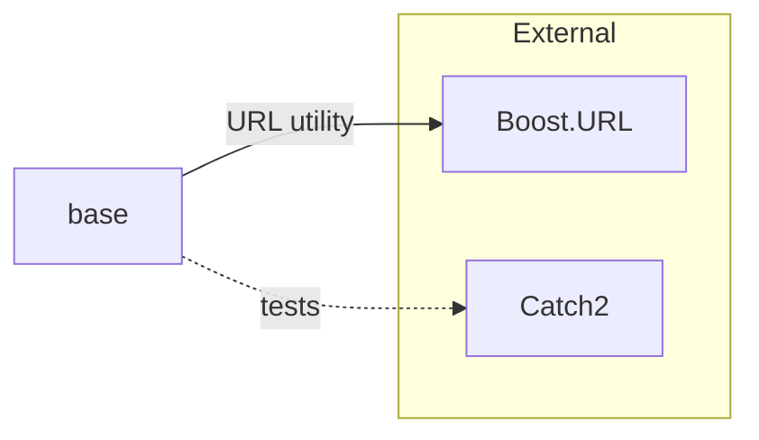
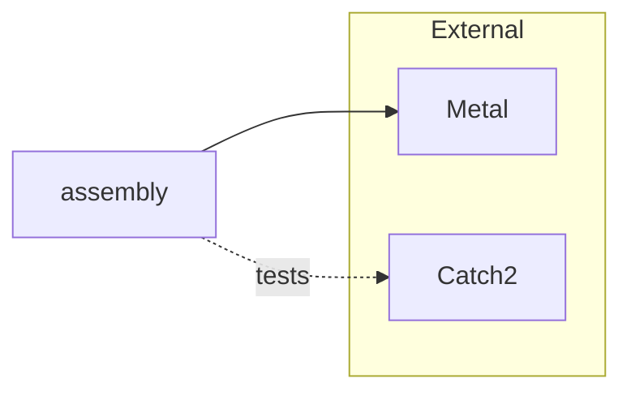
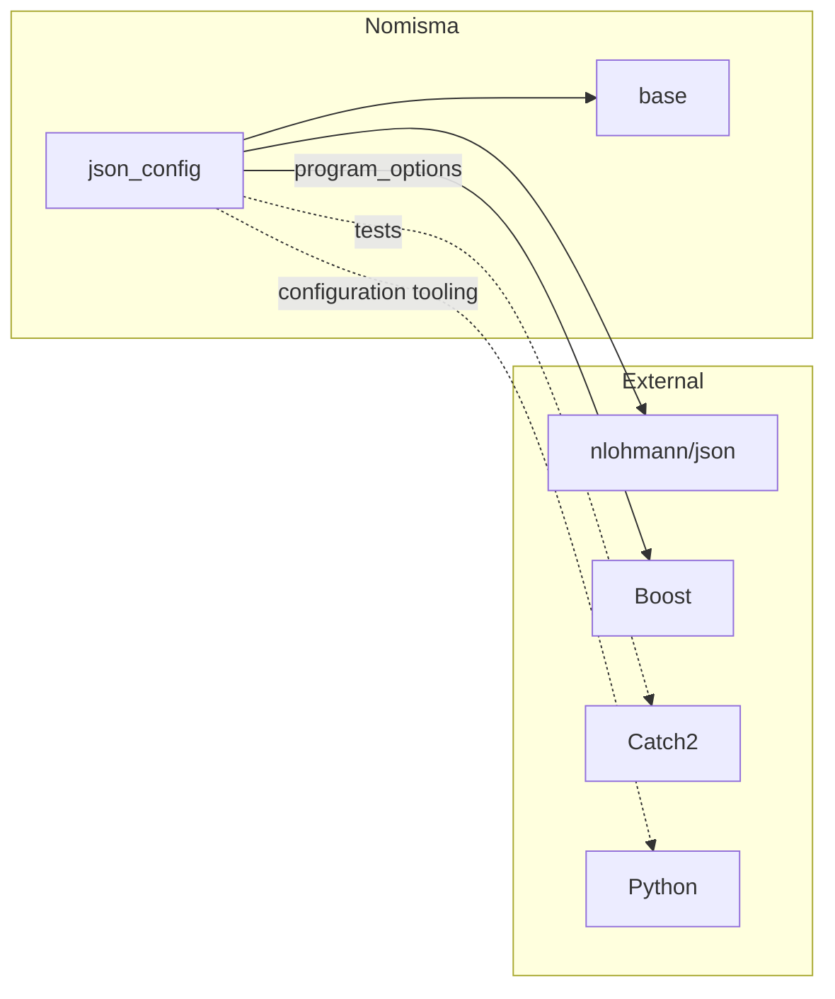
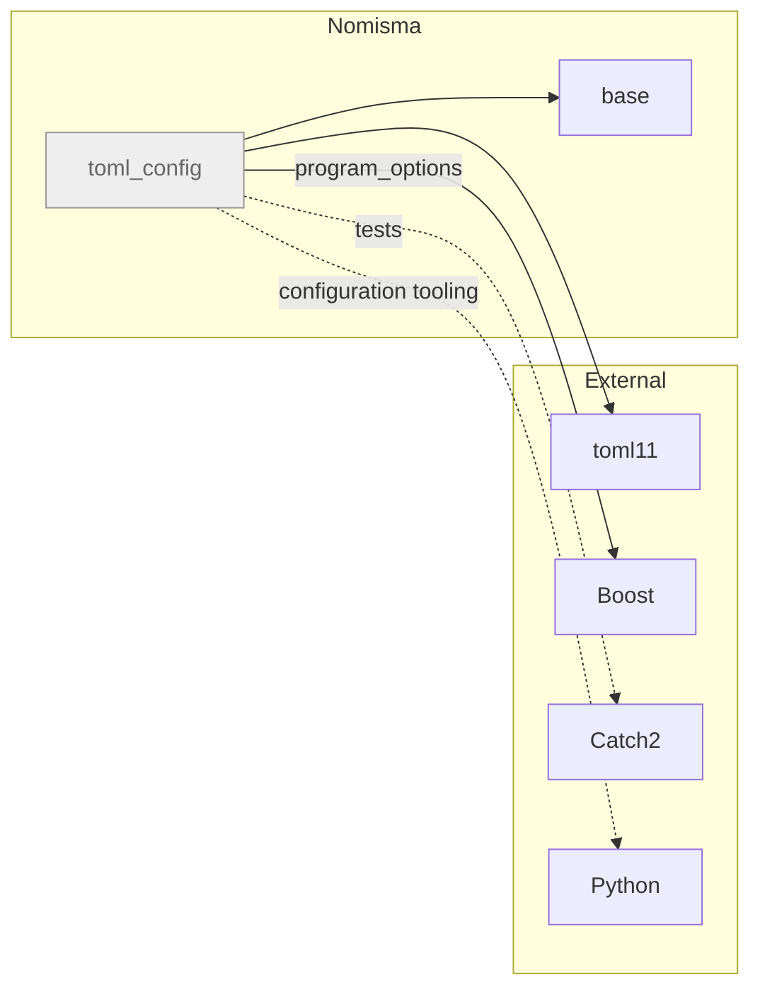
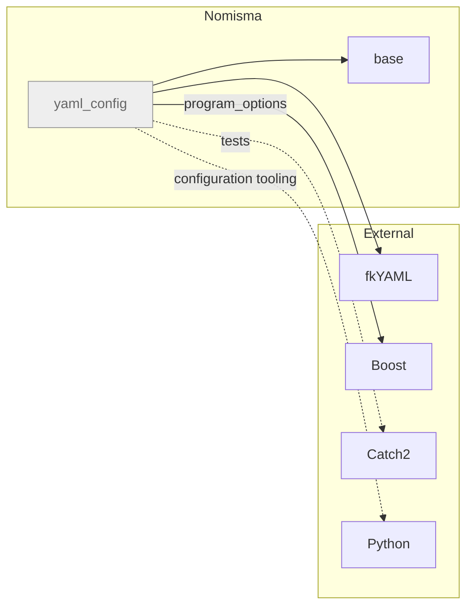
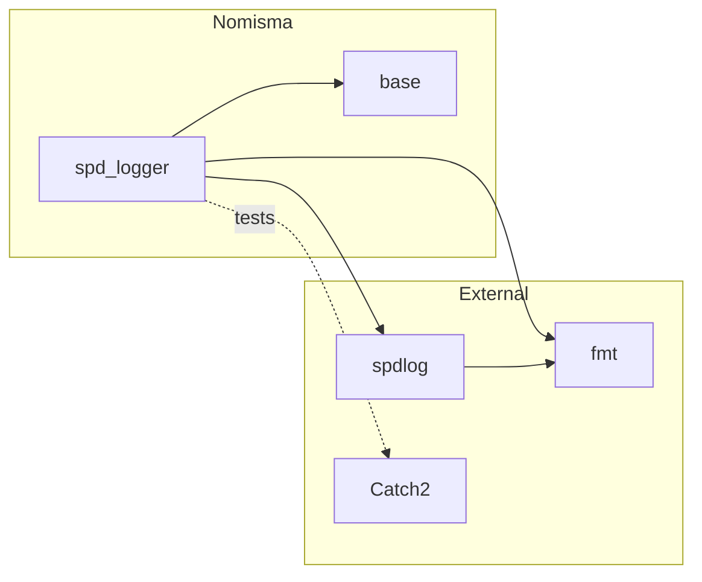
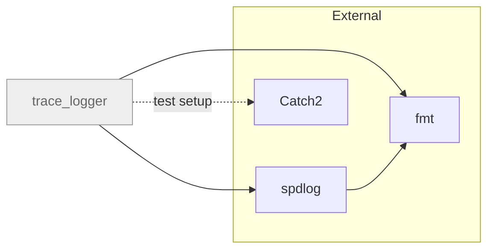

# Core layer: Common types, composition, configuration, logging and performance measurement

Core facade, component status, licensing and performance measurement plan updated
11 November 2026. Component repositories own dependency pins, release history, detailed APIs
and validation records; this document describes their roles and integration boundaries.

The [memorandum](../memorandum.md) records intent and platform decisions. This roadmap tracks
component status and remaining work; operational guidance lives in the component repos.
The [layer overview](layers.md) defines ownership and integration boundaries.
Build infrastructure belongs to the separate [toolchain layer](toolchain-layer.md).

## 1. Components and current status

The table distinguishes facade membership, independently developed components and planned work.

| Repository | Distribution license | Role | Current work |
|---|---|---|---|
| [nom_core](https://github.com/nomisma-labs/nom_core) | MIT | Facade repository for the selected core components | Pins and integrates `base`, `assembly`, `json_config` and `spd_logger`; shared glue APIs are planned. |
| [base](https://github.com/nomisma-labs/base) | MIT | Common definitions shared by core libraries | Included in `nom_core`; owns common utilities and format-independent configuration types. |
| [assembly](https://github.com/nomisma-labs/assembly) | MIT | Integration framework: Node/context composition, bidirectional relay and callable delegates | Included in `nom_core`. |
| [json_config](https://github.com/nomisma-labs/json_config) | MIT | Application configuration with JSON | Included in `nom_core`; consumes common types from `base`. |
| [spd_logger](https://github.com/nomisma-labs/spd_logger) | MIT | Synchronous, single-threaded application logger based on spdlog | Included in `nom_core`; C++ configuration uses `base`. |
| [toml_config](https://github.com/nomisma-labs/toml_config) | MIT | Application configuration with TOML | Outside `nom_core`. Implemented and released; uses common types from `base`. |
| [yaml_config](https://github.com/nomisma-labs/yaml_config) | MIT | Application configuration with YAML | Outside `nom_core`. Implemented and released; generation, loading and mapping use common types from `base` and fkYAML. |
| [trace_logger](https://github.com/nomisma-labs/trace_logger) | Proprietary | High-performance logging prototype | Outside `nom_core`. Under development; retains the `core/` source layout and an older kit. |
| Performance measurement framework | MIT (planned) | Reusable performance measurement for components and workflows | Planned; repository name, API and integration with `nom_core` remain to be defined. |

The [licensing policy](licensing.md) selects MIT for general core products, including the
configuration alternatives and the `nom_core` facade. `trace_logger` remains proprietary as
an explicit know-how exception. License labels describe the selected distribution terms;
existing repository `LICENSE` files currently remain proprietary.
Gray diagram styling indicates absence from `nom_core`, independently of licensing.

Each trading system has a container repository that selects compatible component versions.
Repository creation, shared-kit updates and infrastructure experiments belong to the
[toolchain layer](toolchain-layer.md). `cmake_template` currently provides that tooling to all
code layers through copied and synchronized kit files.

### Library dependencies between repositories

Arrows point from a repository to the repository it depends on. `nom_core` is the facade for
its four associated repositories. Gray nodes are core components outside the current
`nom_core` bundle; the dashed border marks the planned performance measurement framework.
This overview shows only Nomisma dependencies; each repository section below adds its
external dependencies.

All three configuration frameworks depend on `base`. `assembly` remains independent of
configuration and logging. The two logger repositories have distinct APIs and maturity levels.
`toml_config`, `yaml_config` and `trace_logger` remain available independently.

### nom_core facade

**Distribution license: MIT.**

`nom_core` provides one repository dependency for consumers of its selected core components.
It declares all four pins before loading them through FetchContent, so shared dependencies
resolve to the selected versions. The component repositories retain their own APIs and do
not depend back on the facade. The template supplies the shared build mechanisms.
An enclosing project can override the facade's defaults by declaring the shared dependencies
first. Exact pins are recorded by the facade's Git submodules and build declarations.

The current facade provides source dependency integration. Consumers still link the component
targets they use; installed components retain their own packages. An umbrella C++ module,
library target and installed `nom_core` package are not yet defined. Shared adapters between
composition, configuration and logging belong in this repository as their contracts are agreed.

In the local diagrams below, solid arrows show library dependencies and dashed arrows identify
tests, tooling, build setup or example-only use. Shared build tools (CMake, Ninja, compilers and kit
scripts) and the C++ standard library are omitted.

## 2. Conventions

Use `nom` as the root namespace, `nom_` for shared prefixes, and standard-library-style
`snake_case`. Template parameters use `PascalCase`; macros use UPPER_CASE. Module names and
namespace hierarchies are independent: `nom.assembly` exposes its API directly in `nom`.

Nomisma declarations live in native module interfaces and partitions; compiled definitions use
implementation units. Apps and tests import the library's primary module. Macros stay in headers;
third-party dependencies use a tested module wrapper or header boundary. The shared kit
now supports `import std;`; use the current module rules linked below for implementation details.

The canonical [conventions](https://github.com/nomisma-labs/cmake_template/blob/master/docs/kit/conventions.md) define naming, file layout,
target names and enforcement. The [module rules](https://github.com/nomisma-labs/cmake_template/blob/master/docs/kit/build.md#modules)
cover composition and dependency boundaries. Every source file carries the SPDX comments from
the memorandum.

## 3. Build and dependency rules

- Use the shared CMake kit and target-based dependencies. Tests and apps default to enabled
  only for a top-level project, so consuming a library does not build its development tools.
- Pin our libraries as Git submodules and integrate them through FetchContent. The system repo
  selects shared dependency versions and declares their pins before populating dependencies;
  consistent names let multiple dependency paths resolve to one instance.
- Pin third-party source dependencies to releases and integrate them case by case. Use
  `find_package` for system libraries. Local source overrides support co-development before
  updating a submodule pin.
- Support both source consumption and installed packages. Install module interface sources
  and required headers; consumers build their own compiler-specific BMIs.
- Keep shared infrastructure changes in `cmake_template`, then synchronize derived repos.
  Each repo records its template revision in `.template_ref`.

The [build guide](https://github.com/nomisma-labs/cmake_template/blob/master/docs/kit/build.md) covers presets, dependency integration,
installation and tooling. Use `./bootstrap.sh` for fresh validation and preset build/test commands
for incremental work.

Every repo starts versioned at `0.1.0`, follows Semantic Versioning, and keeps its version in
`project()`. Annotated `vX.Y.Z` tags identify releases on `master`; CI checks tag/version agreement.
The [release procedure](https://github.com/nomisma-labs/cmake_template/blob/master/docs/kit/build.md#versioning) is maintained in the template.

## 4. Base: Common definitions

**Distribution license: MIT.**

`base` holds common definitions used across the core layer: configuration types, enum and
forced-inlining macros, and the owning HTTPS/WSS URL utility. Configuration types depend only
on the standard library; `nom::base_url` uses Boost.URL, which the base package discovers.
Consumers of configuration types import
`nom.config_types` and link `nom::config_types` from the `base` package. `json_config`,
`toml_config` and `yaml_config` add mapping and loading for their respective formats;
`spd_logger` uses the types directly in C++ configuration objects.
See the [type guide](https://github.com/nomisma-labs/base/blob/master/docs/base/config_types.md).

## 5. Assembly : Integration Framework

**Distribution license: MIT.**

Assembly composes processing nodes at compile time. Relay passes requests forward and responses
back through matching handlers; context mixins contribute shared state and services. Delegates
connect runtime event sources to the static framework. Assembly custom traits configure node
policies and list the events without a final consumer, which the relay suppresses at the end of
each route. An exception escaping event processing is fatal by policy. Metal supplies the
typelist machinery inside the module; applications declare lists with `nom::type_list`.

Start with **[How to understand Assembly/Relay applications](https://github.com/nomisma-labs/assembly/blob/master/docs/assembly/understanding_applications.md)**:
read the node list, then identify context services, event handlers, trait choices, configuration
reads, and original event emitters.

Assembly is the first library created from the template and exercises template-heavy module
code. Review the [framework guide](https://github.com/nomisma-labs/assembly/blob/master/docs/assembly/framework.md) and
[teaching tests](https://github.com/nomisma-labs/assembly/blob/master/docs/assembly/tests.md).

The repository includes the teaching suites
`assembly`, `custom_traits`, `relay`, `complex_relay` and `delegate`, plus source/package
consumer checks. Validation records live with the component.

## 6. App Config

The application configuration library has three format implementations:
[json_config](https://github.com/nomisma-labs/json_config) based on JSON,
[toml_config](https://github.com/nomisma-labs/toml_config) based on TOML, and
[yaml_config](https://github.com/nomisma-labs/yaml_config) based on YAML. A project chooses one
framework for its configuration. All three use the common C++ types from `base` and closely
follow the same language concepts, tools and documentation structure. `nom_core` currently
selects `json_config`; TOML and YAML remain outside the facade. Assembly and both loggers remain
independent of the configuration implementations.

### json_config

**Distribution license: MIT.**

`json_config` uses the common configuration types from `base`.

The [jcfg language guide](https://github.com/nomisma-labs/json_config/blob/master/docs/json_config/jcfg.md)
defines layered configuration through worked examples. Four components support the complete
JSON configuration workflow:

- **Python generation:** `jcfggen.py` assembles inherited sections and imported fragments into
  ordinary JSON files.
- **Build integration:** the shared kit collects source configs; json_config supplies generation,
  per-section tests, cleanup and config installation helpers.
- **C++ location and loading:** applications resolve a config file, apply runtime variables and
  command-line overrides, then map and validate the configuration.
- **JSON/C++ mapping:** `NOM_JCONFIG` uses nlohmann/json with common C++ config types. Application
  structures own their validation. Macros stay in headers; reusable types and services use modules.

The [component guides](https://github.com/nomisma-labs/json_config/blob/master/docs/json_config/README.md)
document each part. The [md_capture example](https://github.com/nomisma-labs/json_config/blob/master/apps/md_capture/README.md)
connects the language guide to C++ application code;
[config_workflow_example](https://github.com/nomisma-labs/json_config/blob/master/apps/config_workflow_example/README.md)
covers generation, loading, `--check-config`, testing and installation. Tests exercise the full
workflow and [native C++ consumers](https://github.com/nomisma-labs/json_config/blob/master/tests/integration/library_usage/README.md)
using both source integration and the installed package.

### toml_config

**Distribution license: MIT.**

Not included in the current `nom_core` bundle.

The TOML workflow uses `base` for configuration types, toml11 for TOML conversion, and
Boost.Program_options for command-line parsing.

The [tcfg language guide](https://github.com/nomisma-labs/toml_config/blob/master/docs/toml_config/tcfg.md)
maps the jcfg design to TOML. Four components support the complete workflow:

- **Python generation:** `tcfggen.py` resolves inherited sections, literal imports, fragment
  pointers, merge/delete/override instructions and generation variables into ordinary TOML.
- **Build integration:** the shared kit collects configs; `nom_tcfg_generate()` and
  `nom_tcfg_test()` add generation, per-section checks, cleanup and installation checks.
- **C++ location and loading:** `nom::tcfg::load_config()` locates and parses the file, substitutes
  runtime variables, applies ordered overrides, maps the values and calls root validation.
  `--check-config` supports full, view and silent output modes.
- **TOML/C++ mapping:** `NOM_TCONFIG` and `NOM_TCONFIG_ENUM` supply checked numeric conversions,
  nested defaults, optional members, containers, custom converters and explicit enum names.
  Omitted optional keys preserve C++ initializers; empty optionals serialize by omission.
  TOML has no null sentinel.

The [component guides](https://github.com/nomisma-labs/toml_config/blob/master/docs/toml_config/README.md)
follow the JSON framework's structure. Examples cover the full configuration workflow,
application arguments alongside configuration options, and the larger `md_capture` configuration.
The latter demonstrates configuration rather than operating an exchange capture service.
Validation covers generation/build tests, application CLI checks, and
[source and installed consumers](https://github.com/nomisma-labs/toml_config/blob/master/tests/integration/library_usage/README.md).
The repository's [work list](https://github.com/nomisma-labs/toml_config/blob/master/TODO.md)
records retained decisions, including the `sections` envelope and pointer addressing.

### yaml_config

**Distribution license: MIT.**

Not included in the current `nom_core` bundle.

`yaml_config` adds the `ycfg` language, Python generation, CMake generation and deployment
helpers, a C++ loader, and native fkYAML mappings. It follows the configuration framework
structure used by JSON and TOML, with shared value types from `base`.
Its C++ parser uses a compatibility overlay on fkYAML, and its Python generator uses PyYAML.
Dependency versions, the supported YAML profile and parser fixes are documented in the
component guides and parser research below.
Its first release is published; release history and validation records live in the repository.
See the [component guides](https://github.com/nomisma-labs/yaml_config/blob/master/docs/yaml_config/README.md),
[parser research](https://github.com/nomisma-labs/yaml_config/blob/master/docs/yaml_config/parser_research.md)
and [work plan](https://github.com/nomisma-labs/yaml_config/blob/master/TODO.md).

## 7. Logger

The two logging repositories have separate implementation and performance goals, and neither
depends on the other. `nom_core` selects `spd_logger`; `trace_logger` remains an independent,
proprietary component.

### spd_logger

**Distribution license: MIT.**

`spd_logger` provides the owning `nom::logger`, global `nom::main_logger`, and `LDEBUG`, `LINFO`,
`LWARN`, `LERROR` and `LALWAYS` macros. `NOM_LOG` and `NOM_LOG_NOEXCEPT` accept an explicit logger.
The global wrapper exists before `main()` and starts empty; initialize it before use. Output
and flushing run synchronously on the calling thread. Each instance uses a single-threaded
spdlog sink; concurrent use of one instance is outside its contract. Configuration is ordinary
C++ data using `base`, with console or file output and optional rotation. Its module is `nom.spd_logger`;
macros stay in a header. Start with the
[small example](https://github.com/nomisma-labs/spd_logger/blob/master/apps/logger_example/main.cpp).

### trace_logger

**Distribution license: Proprietary.**

Not included in the current `nom_core` bundle.

`trace_logger` remains a prototype: the trace-capture implementation lives in
`apps/trace_logger/trace_logger.h`, while `core/trace_logger/` supplies its current library module
and logging support. It has not adopted the current `src/` layout or `import std` toolchain.
Both logger repositories pin spdlog and fmt independently, with spdlog configured to use the
external fmt library.

## 8. Performance measurement framework

**Distribution license: MIT (planned component).**

A new core component is planned for reusable performance measurement of components and
workflows. Its repository name, public API, dependencies and integration with `nom_core`
remain to be defined. The framework is not part of the current core bundle.
