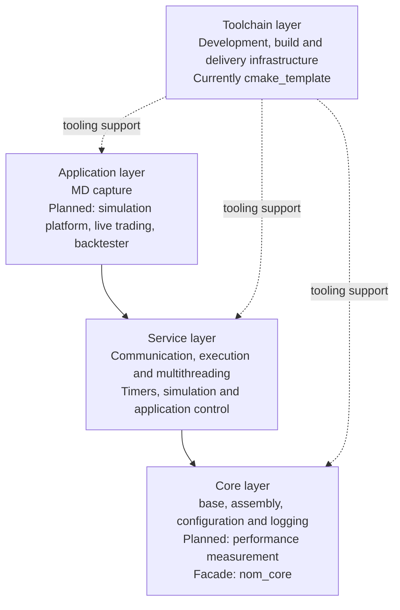

# Layers and integration boundaries

Nomisma separates development tooling, core libraries, reusable runtime services, and
applications. Each layer owns its components and the integration needed to use them together.
This document records the ownership boundaries; the roadmaps cover the
[toolchain](toolchain-layer.md), [core](core-layer.md), [service](service-layer.md), and
[application](application-layer.md) layers. Layer names describe responsibilities independently
of the repositories that implement them. The [licensing plan](licensing.md) defines MIT,
Sustainable Use License 1.0 and proprietary distribution independently of those boundaries.
License labels below refer to the selected distribution terms; existing repository notices
currently remain proprietary.

## Layer dependencies

Solid arrows show **direct repository dependencies** between code layers. Dashed arrows show
**tooling support**, such as repository setup, builds and validation. The diagram includes
planned execution, multithreading, and simulation facilities.

| Layer | Owns | Examples |
| --- | --- | --- |
| Toolchain | Repository setup, build and test infrastructure, development conventions, packaging, and shared-tool updates | `cmake_template` (**Proprietary**) and its synchronized kit |
| Core | Common definitions, component composition, configuration, logging, adapters and planned performance measurement | `base`, `assembly` and `nom_core` (**MIT**); planned shared logger-configuration mapping |
| Service | Reusable runtime facilities provided to applications and integration between those facilities | `asio_comm` and planned `nom_services` (**SUL 1.0**); timers, execution, multithreading, simulation and application control |
| Application | Selection and composition of services, domain behavior, configuration values, and operational policy | `md_capture` (**SUL 1.0**); planned simulation platform, live trading platform and backtester (**all Proprietary**) |

The repository dependency chain is **Application → Service → Core**. Applications obtain core
components transitively through their service-layer dependencies. Core does not depend on
service implementations or execution backends. Execution contracts, simulation engines and
schedulers belong to the service layer. Application-level simulation platforms compose these
services into trading workflows and own the scenarios and interpretation of results.

The toolchain layer supports all three code layers. `cmake_template` currently supplies this
infrastructure through the copied and synchronized kit; it is not a runtime dependency. The
layer can retain its name if that repository is replaced, split, or supplemented later.

## Repository layout

Repositories remain independent. Workspace directories such as `core/`, `services/` and
`toolchain/` group related repositories without merging them. A repository can contain
components from more than one layer; responsibilities and dependencies determine placement.

Inside every repository, reusable library sources belong in `src/<component>/`, regardless of
their architectural layer. Applications remain in `apps/<exchange>/<app>/` or `apps/<app>/`.
Documentation stays in `docs/<repo>/` and tools in `tools/<repo>/`, with no extra layer directories.

## Core integration

`nom_core` (**MIT**) is the facade for a compatible selection of core components. Component
libraries retain their own repositories and APIs; they do not depend back on the facade.
Reusable adapters between composition, configuration and logging belong in the core layer,
with shared integration planned in `nom_core`.

Configuration and logging illustrate the ownership boundary:

| Responsibility | Owner |
| --- | --- |
| Common configuration value types | `base` (**MIT**) |
| A component's configuration structure, defaults and validation | The component itself, such as `spd_logger` (**MIT**) |
| Format-specific loading and mapping mechanisms | `json_config`, `toml_config` and `yaml_config` (**all MIT**) |
| Adapters connecting component types to a configuration framework | Core integration, planned in `nom_core` (**MIT**) |
| Selected configuration values and startup policy | The application |

This separation keeps components independent of a particular configuration format while
allowing applications to reuse their integration. The [core plan](core-layer.md) records
facade membership, component status and planned adapters.

## Services supplied to applications

Reusable execution, scheduling, thread management and lifecycle mechanisms belong in the
service layer. Shared runtime integration is planned in `nom_services` (**SUL 1.0**).
Core composition connects components; it does not own execution or application policy.

Applications select and configure services, define domain workflows, and decide what counts
as readiness, completion or failure. Service mechanisms support those decisions without
embedding application-specific rules. The [service plan](service-layer.md) and
[application plan](application-layer.md) record the components and planned work; concrete APIs
and runtime behavior belong in the component repositories.
