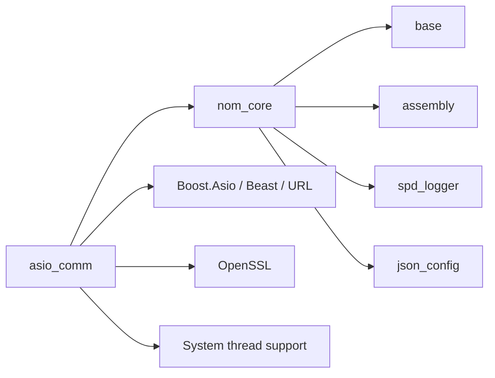

# Service layer: Communication, execution and API facilities

Updated 11 November 2026.

The [memorandum](../memorandum.md#architecture-directory) places reusable runtime services
above the [core layer](core-layer.md). Applications compose these services into
workflows described in the [application layer](application-layer.md). Component APIs, usage
constraints and validation evidence live with their code.

The selected distribution license for `asio_comm` and the planned `nom_services` repository is
**Sustainable Use License 1.0 (SUL 1.0)**, under the [licensing plan](licensing.md).
`asio_comm` records these source-available terms in its repository notices; `nom_services`
remains planned. Future service repositories need an explicit selection.

## Components and status

| Component | Distribution license | Responsibility | Status |
| --- | --- | --- | --- |
| [asio_comm](https://github.com/nomisma-labs/asio_comm) | SUL 1.0 | TLS WebSocket, HTTPS/HTTP/1.1 and timers based on Boost.Asio and Boost.Beast | Implemented; consumes core dependencies through `nom_core`. Further validation and feature work remain. |
| Shared runtime integration (`nom_services`) | SUL 1.0 (planned) | Execution-context and lifecycle facilities reused across applications | Planned; `asio_service` and application control/termination currently live in application headers. |
| Multithreading facilities | Unassigned; repository undefined | Execution domains, worker lifecycle and explicit event transfer between threads | Future work; interfaces and repository boundaries remain to be designed. |
| Application API facilities | Unassigned; repository undefined | Expose application commands, queries and event streams to external clients | Future work; protocol, interface style and framework remain undecided. |

Additional services can join this layer as applications need them. Trading strategies and
capture/storage policy belong to applications. Exchange-specific subscription semantics belong
to feed adapters, including examples hosted in `asio_comm`, rather than its reusable transport API.

## Communication: asio_comm

**Distribution license: Sustainable Use License 1.0 (source available).**

The `nom.asio_comm` module exposes three components:

- [`nom::web_socket`](https://github.com/nomisma-labs/asio_comm/blob/master/docs/asio_comm/web_socket.md):
  TLS WebSocket lifecycle and events, validated parameters, message limits, connection deadlines,
  automatic server-Ping replies and optional active/passive control-Ping monitoring.
- [`nom::https`](https://github.com/nomisma-labs/asio_comm/blob/master/docs/asio_comm/https.md):
  asynchronous HTTP/1.1 over verified TLS, bounded request queuing and connection/request/shutdown
  deadlines. One request/response exchange is active at a time.
- [`nom::timer`](https://github.com/nomisma-labs/asio_comm/blob/master/docs/asio_comm/timer.md):
  one-shot monotonic scheduling with generation-safe cancellation/rearming and move support.

Protocol state machines make completion, failure, cancellation and ownership transitions
explicit. Public client `close()` is silent and immediate. WebSocket sends currently block the
calling thread; HTTPS sends use the asynchronous queue. Calls and callbacks must be serialized
within the component's execution domain. The library does not create an application worker pool.

The source repository composition is shown below. `nom_core` supplies
the core component targets; `asio_comm` still links the targets it uses explicitly, and installed
packages find those component packages directly. `json_config` comes with the facade but is not
used by the communication library.

The [toolchain layer](toolchain-layer.md), currently implemented by `cmake_template`,
supplies the shared CMake kit and validation tools. Assembly/relay composes example applications
and routes events synchronously. Its routing does not schedule work or transfer ownership
across threads.

The [examples](https://github.com/nomisma-labs/asio_comm/blob/master/apps/README.md) include
20 market-data feeders and 19 WebSocket/HTTPS symbol providers, with API references and
explicit Assembly/relay integration. These are integration examples, not complete capture
services. Exchange adapters own application heartbeats, subscriptions, payload interpretation
and useful-data freshness; an application owns reconnection and persistence policy.

Local build and source/installed-consumer checks cover dependency integration. Detailed test
results and [saved live checks](https://github.com/nomisma-labs/asio_comm/blob/master/apps/conn_test_summary.md)
belong with the repository. Short connectivity checks do not establish sustained availability,
lossless capture, private-feed or order-execution readiness.

Remaining communication work is tracked in the repository's
[work plan](https://github.com/nomisma-labs/asio_comm/blob/master/src/asio_comm/current_work.md)
and [WebSocket stages](https://github.com/nomisma-labs/asio_comm/blob/master/src/asio_comm/ws_current_work.md):
long-running Ping/network-loss validation, close-timeout coverage, the exception audit,
HTTP sending enhancements and optional transport choices. The
[backlog](https://github.com/nomisma-labs/asio_comm/blob/master/TODO.md) also tracks future CI/CD
connectivity checks and a possible GitHub results dashboard.

The source links above use the implemented [`src/` layout](layers.md#repository-layout).

## Future execution and multithreading services

Define execution-domain ownership, startup/shutdown and cross-thread event delivery before
adding worker facilities. Queued transfer needs owned data, ordering, backpressure and a clear
point at which callbacks have stopped. The existing synchronous relay does not supply those
guarantees by itself.

The communication repository contains an execution/simulation proposal covering engines,
executors, clock domains and replay. It remains a proposal; the current Asio-backed timer is
implemented, while backend-neutral execution and virtual time are future work. Keep those
contracts reusable across communication clients and applications rather than embedding them
in an exchange feeder.

## Future application API services

Provide reusable facilities for exposing application functionality to external clients.
The API approach remains open: a conventional HTTP/REST interface or an RPC/binary alternative
where efficiency requirements justify it. gRPC is not preferred given prior experience with it;
no protocol, serialization format or framework has been selected.

Define the required clients, commands, queries and event subscriptions before selecting the
approach. Assess compatibility/versioning, authentication, deadlines, cancellation and
backpressure alongside measured performance and integration complexity. Applications own the
domain operations and access policy; this component supplies the reusable API infrastructure.
