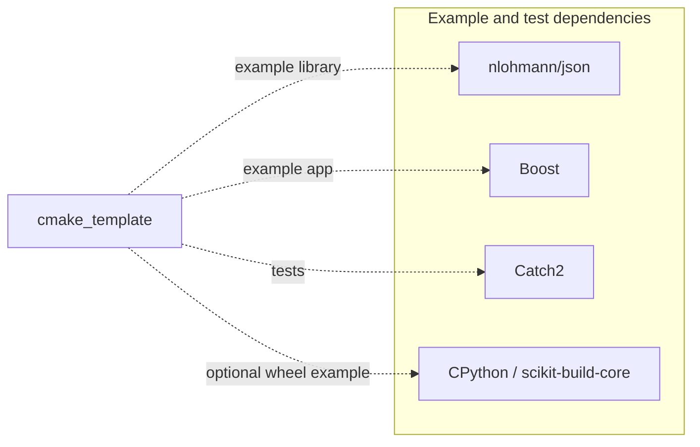

# Toolchain layer: Development, build and delivery infrastructure

Updated 11 November 2026.

The **toolchain layer** provides the tools and conventions used to create, build, test and
distribute Nomisma components. Its current implementation is the
[`cmake_template`](https://github.com/nomisma-labs/cmake_template) repository. The layer name
describes its responsibility: its implementation may later change or span several repositories.

It supports the [core](core-layer.md), [service](service-layer.md) and
[application](application-layer.md) layers. See [Layers and integration boundaries](layers.md)
for the distinction between tooling support and library dependencies.

## Responsibilities

| Area | Responsibility |
| --- | --- |
| Repository setup | Starting layout, initialization, shared conventions and development guidance |
| Build environment | Compiler and standard-library compatibility, CMake helpers, presets and dependency integration |
| Validation | Test integration, formatting and source checks, sanitizers, CI workflows and development images |
| Delivery | Installation, package exports and packaging mechanisms |
| Shared evolution | Kit synchronization and experiments that establish changes to the supported toolchain |

Each component repository chooses its targets, dependencies, configuration and release version.
The `nom_core` facade selects compatible core components; `nom_services` remains planned.
Shared adapters are intended to live in their respective facade repositories. The toolchain
supplies the mechanisms they use; it does not choose their component sets or own application behavior.

## Current implementation: cmake_template

**License: Proprietary (private internal tooling).** See the [licensing plan](licensing.md).

`cmake_template` supplies a repository skeleton and a shared kit. The kit includes CMake helpers,
presets, checks, CI workflows and documentation. New repositories receive copies of these files;
later synchronization transfers updates and records the template revision in `.template_ref`.
`cmake_template` is not linked into applications or added as a runtime dependency.

The repository also provides a lab for changes that affect multiple components. Its example
module exercises native C++ modules, partitions, implementation units and third-party boundaries.
Tests cover source and installed-package consumption, app selection and installation relocation.
Example dependencies exercise those features; each derived repository declares its own dependencies.

The repository initializer removes the example and lab, leaving a starting layout for the new
component. Repository settings and access to private dependencies need their own setup.

Shared build behavior changes in `cmake_template` first, then reaches consuming repositories
through kit synchronization. A change that also affects component code requires a coordinated
migration of that code and its tests. Compiler or language-standard upgrades should be validated
in the lab before changing the shared baseline.

The workspace groups toolchain repositories under `toolchain/`, alongside `core/` and
`services/`. Its current implementation lives in `toolchain/cmake_template/`, keeping the
repository name independent of the layer name. `md_capture/` remains at the workspace root,
and `research/` holds local investigations and source checkouts.

The agreed [repository layout](layers.md#repository-layout) uses `src/<component>/` for library
sources in every code layer. Documentation remains in `docs/<repo>/` and tools in `tools/<repo>/`.
The template implements this convention. The bundled core components, JSON/TOML/YAML
configuration frameworks, `asio_comm` and `md_capture` use it. `trace_logger` still uses `core/`
and an older kit. Its migration requires repository-owned source and CMake changes alongside
kit synchronization.

## Validation, delivery and documentation

The shared kit defines the compiler and standard-library baseline, presets, checks and CI
workflows. Exact tool versions and supported environments live in the template's build guide
and CI image. The lab records module, performance, IDE/debugger and platform investigations.
Local validation, hosted CI results and published images are separate evidence of readiness.

Packaging mechanisms and generic access to private build dependencies belong here. Component
repositories choose package contents and audience. The [memorandum](../memorandum.md) and
[licensing plan](licensing.md) define MIT, SUL 1.0 and proprietary distribution. The
template remains private and proprietary; a distributed component must provide the build
support its audience needs. The redistribution scope and terms for copied kit files remain an
[open distribution decision](licensing.md#open-distribution-decisions). Public CI images should
contain public tools, while private dependency access is configured separately.

Cross-repository decisions and plans live in this handbook. Component APIs and operational
guides live with their code. The toolchain supplies shared conventions and recipes, and
changes to shared behavior should include the corresponding documentation updates.

## Guides and planned work

- [Create a repository](https://github.com/nomisma-labs/cmake_template/blob/master/docs/kit/new_repo.md)
  and [synchronize its kit](https://github.com/nomisma-labs/cmake_template/blob/master/docs/kit/new_repo.md#keeping-repos-in-sync).
- [Build and toolchain guide](https://github.com/nomisma-labs/cmake_template/blob/master/docs/kit/build.md),
  [code recipes](https://github.com/nomisma-labs/cmake_template/blob/master/docs/kit/howto.md) and
  [conventions](https://github.com/nomisma-labs/cmake_template/blob/master/docs/kit/conventions.md).
- [Toolchain backlog](wip/cmake_template.md), [implementation reference](wip/cmake_template_reference.md)
  and [packaging plan](wip/packaging.md).
- [Lab findings](https://github.com/nomisma-labs/cmake_template/blob/master/docs/lab/README.md)
  and [release history](https://github.com/nomisma-labs/cmake_template/blob/master/CHANGELOG.md).
