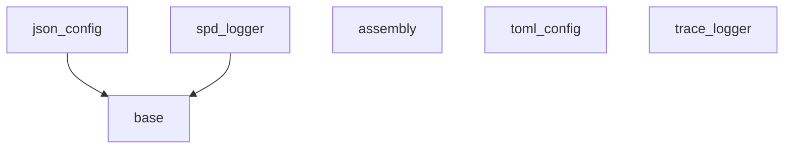
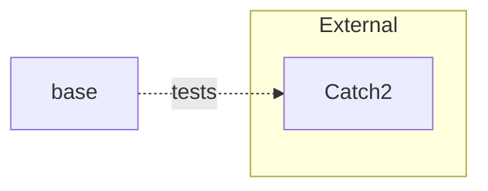
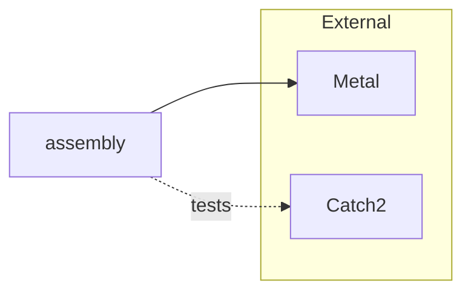
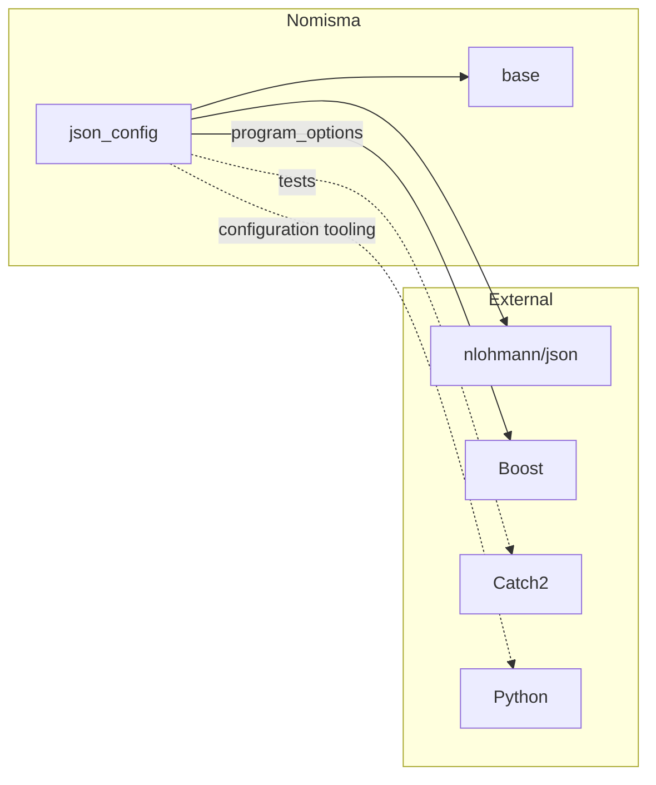
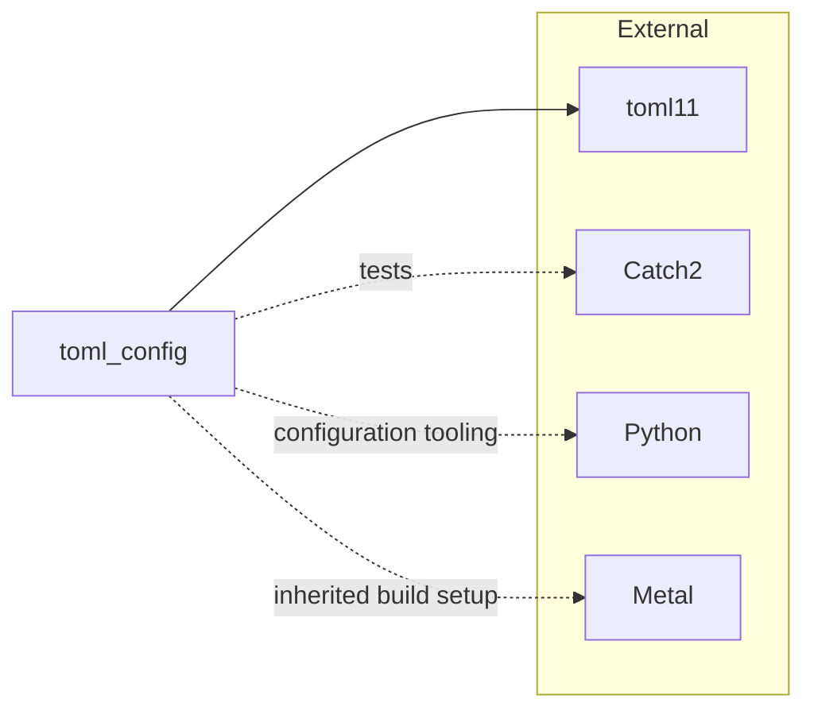
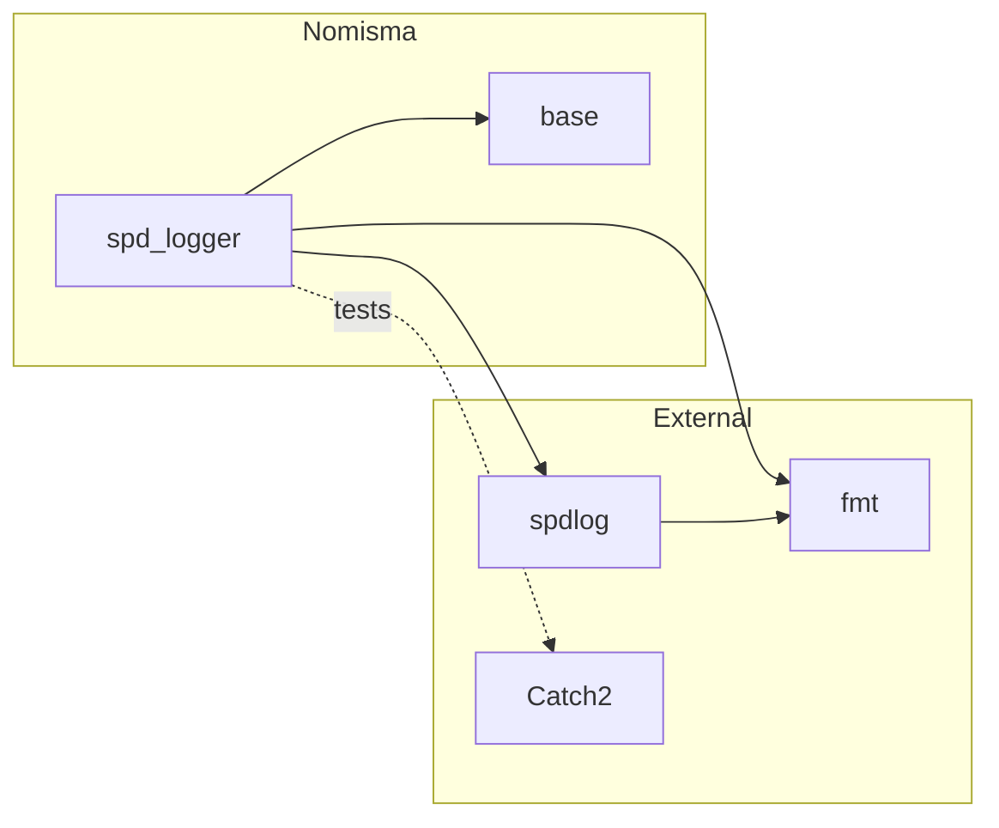
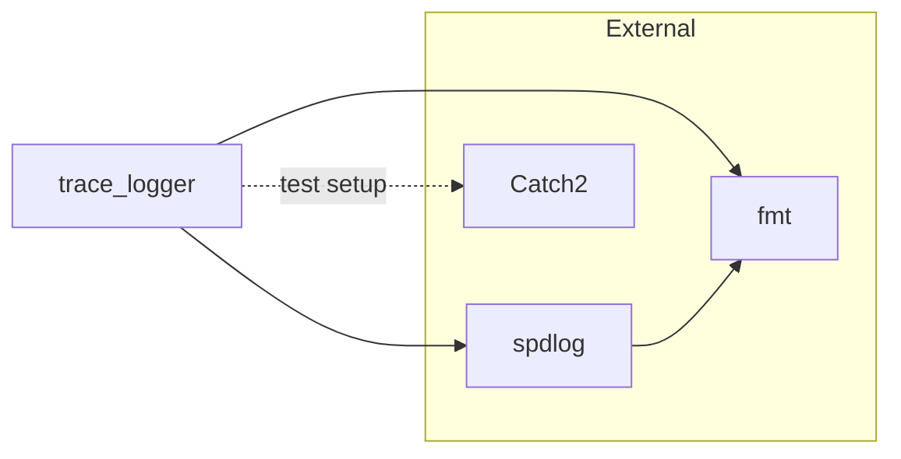

# Core layer: Common types, composition, configuration and logging

Layer boundaries updated 8 November 2026. Component status below retains the 17 October 2026
snapshot; consult each repository for subsequent releases.

The [memorandum](../memorandum.md) records intent and platform decisions. This roadmap tracks
implementation order and remaining work; operational guidance lives in the component repos.
The [layer overview](layers.md) defines ownership and the planned `nom_core` integration.
Build infrastructure belongs to the separate [toolchain layer](toolchain-layer.md).

## 1. Sequence and current status

Each step should build, pass its tests, and provide the facilities needed by the next component.

| Repository | Role | Current work |
|---|---|---|
| [base](https://github.com/nomisma-labs/base) | Common definitions shared by core libraries | Released as `v0.1.0`; owns the format-independent configuration types extracted from `json_config`. |
| [assembly](https://github.com/nomisma-labs/assembly) | Integration framework: Node/context composition, bidirectional relay and callable delegates | Framework complete; released as `v0.2.0`. |
| [json_config](https://github.com/nomisma-labs/json_config), [toml_config](https://github.com/nomisma-labs/toml_config) | Application configuration library with JSON and TOML implementations | JSON workflow released as `v0.1.0`; now consumes common types from `base`. TOML implementation exists; shared-type adoption remains pending. |
| [spd_logger](https://github.com/nomisma-labs/spd_logger) | General-purpose, synchronous application logger based on spdlog | Released as `v0.1.1`; one eager global logger, single-threaded operation and C++ configuration using `base`. |
| [trace_logger](https://github.com/nomisma-labs/trace_logger) | High performance logging services and macro interface | Created, early stage |

Each trading system has a container repository that selects compatible component versions.
Repository creation, shared-kit updates and infrastructure experiments belong to the
[toolchain layer](toolchain-layer.md). `cmake_template` currently provides that tooling to all
code layers through copied and synchronized kit files.

### Library dependencies between repositories

Arrows point from a library to the repository it depends on. This overview shows only Nomisma
dependencies; each repository section below adds its external dependencies.

These are the current dependencies. `assembly` remains independent of configuration and logging;
`toml_config` has not yet adopted `base`. The two logger repositories are independent alternatives.
Each consuming repository owns its dependency declarations; the template supplies shared build
mechanisms.

In the local diagrams below, solid arrows show library dependencies and dashed arrows identify
tests, tooling, build setup or example-only use. Shared build tools (CMake, Ninja, compilers and kit
scripts) and the C++ standard library are omitted.

## 2. Conventions

Use `nom` as the root namespace, `nom_` for shared prefixes, and standard-library-style
`snake_case`. Template parameters use `PascalCase`; macros use UPPER_CASE. Module names and
namespace hierarchies are independent: `nom.assembly` exposes its API directly in `nom`.

Nomisma declarations live in native module interfaces and partitions; compiled definitions use
implementation units. Apps and tests import the library's primary module. Macros stay in headers;
third-party dependencies use a tested module wrapper or header boundary. The shared kit
now supports `import std;`; use the current module rules linked below for implementation details.

The canonical [conventions](https://github.com/nomisma-labs/cmake_template/blob/master/docs/kit/conventions.md) define naming, file layout,
target names and enforcement. The [module rules](https://github.com/nomisma-labs/cmake_template/blob/master/docs/kit/build.md#modules)
cover composition and dependency boundaries. Every source file carries the SPDX comments from
the memorandum.

## 3. Build and dependency rules

- Use the shared CMake kit and target-based dependencies. Tests and apps default to enabled
  only for a top-level project, so consuming a library does not build its development tools.
- Pin our libraries as Git submodules and integrate them through FetchContent. The system repo
  selects shared dependency versions and declares their pins before populating dependencies;
  consistent names let multiple dependency paths resolve to one instance.
- Pin third-party source dependencies to releases and integrate them case by case. Use
  `find_package` for system libraries. Local source overrides support co-development before
  updating a submodule pin.
- Support both source consumption and installed packages. Install module interface sources
  and required headers; consumers build their own compiler-specific BMIs.
- Keep shared infrastructure changes in `cmake_template`, then synchronize derived repos.
  Each repo records its template revision in `.template_ref`.

The [build guide](https://github.com/nomisma-labs/cmake_template/blob/master/docs/kit/build.md) covers presets, dependency integration,
installation and tooling. Use `./bootstrap.sh` for fresh validation and preset build/test commands
for incremental work.

Every repo starts versioned at `0.1.0`, follows Semantic Versioning, and keeps its version in
`project()`. Annotated `vX.Y.Z` tags identify releases on `master`; CI checks tag/version agreement.
The [release procedure](https://github.com/nomisma-labs/cmake_template/blob/master/docs/kit/build.md#versioning) is maintained in the template.

## 4. Base: Common definitions

`base` holds common definitions used across the core layer. Its first component is the
format-independent configuration types moved from `json_config`, together with their documentation,
tests and CMake exports. The library depends only on the standard library. Consumers import
`nom.config_types` and link `nom::config_types` from the `base` package. `json_config` adds JSON
mapping and loading; `spd_logger` uses the types directly in C++ configuration objects.
See the [type guide](https://github.com/nomisma-labs/base/blob/master/docs/base/config_types.md).

## 5. Assembly : Integration Framework

Assembly composes processing nodes at compile time. Relay passes requests forward and responses
back through matching handlers; context mixins contribute shared state and services. Delegates
connect runtime event sources to the static framework. Assembly custom traits configure node
policies and list the events without a final consumer, which the relay suppresses at the end of
each route. An exception escaping event processing is fatal by policy. Metal supplies the
typelist machinery inside the module; applications declare lists with `nom::type_list`.

Start with **[How to understand Assembly/Relay applications](https://github.com/nomisma-labs/assembly/blob/master/docs/assembly/understanding_applications.md)**:
read the node list, then identify context services, event handlers, trait choices, configuration
reads, and original event emitters.

Assembly is the first library created from the template and exercises template-heavy module
code. Review the [framework guide](https://github.com/nomisma-labs/assembly/blob/master/docs/assembly/framework.md) and
[teaching tests](https://github.com/nomisma-labs/assembly/blob/master/docs/assembly/tests.md).

The framework is complete and released as `v0.2.0`. Its five
teaching suites (`assembly`, `custom_traits`, `relay`, `complex_relay` and `delegate`) and
source/package consumers pass locally on GCC and Clang.

## 6. App Config

The application configuration library has two format implementations:
[json_config](https://github.com/nomisma-labs/json_config) based on JSON and
[toml_config](https://github.com/nomisma-labs/toml_config) based on TOML. Apps and components choose
the implementation they need; Assembly and both loggers remain independent of either implementation.

### json_config

The JSON workflow is released as `v0.1.0` and now consumes the common types from `base`.

The [jcfg language guide](https://github.com/nomisma-labs/json_config/blob/master/docs/json_config/jcfg.md)
defines layered configuration through worked examples. Four components support the complete
JSON configuration workflow:

- **Python generation:** `jcfggen.py` assembles inherited sections and imported fragments into
  ordinary JSON files.
- **Build integration:** the shared kit collects source configs; json_config supplies generation,
  per-section tests, cleanup and config installation helpers.
- **C++ location and loading:** applications resolve a config file, apply runtime variables and
  command-line overrides, then map and validate the configuration.
- **JSON/C++ mapping:** `NOM_JCONFIG` uses nlohmann/json with common C++ config types. Application
  structures own their validation. Macros stay in headers; reusable types and services use modules.

The [component guides](https://github.com/nomisma-labs/json_config/blob/master/docs/json_config/README.md)
document each part. The [md_capture example](https://github.com/nomisma-labs/json_config/blob/master/apps/md_capture/README.md)
connects the language guide to C++ application code;
[config_workflow_example](https://github.com/nomisma-labs/json_config/blob/master/apps/config_workflow_example/README.md)
covers generation, loading, `--check-config`, testing and installation. Tests exercise the full
workflow and [native C++ consumers](https://github.com/nomisma-labs/json_config/blob/master/tests/integration/library_usage/README.md)
using both source integration and the installed package.

### toml_config

TOML already has a Python configuration generator and C++ discovery, loading and binding support.
It has not yet adopted the common types from `base`. Its build still populates and installs Metal,
although the library does not use it. See the
[repository guide](https://github.com/nomisma-labs/toml_config/blob/master/README.md).

## 7. Logger

The two logger repositories are independent alternatives. Their matching interfaces are intentional:
an application chooses one implementation, and neither logger depends on the other.

### spd_logger

`spd_logger` provides general-purpose logging through `DEBUG`, `INFO`, `WARN`, `ERROR` and
`ALWAYS`. One global object is initialized with its translation unit; output and flushing run
synchronously on the calling thread. Configuration is ordinary C++ data using `base`, with
console or file output and optional rotation. Its module is `nom.spd_logger`; macros stay in a
header. Start with the [small example](https://github.com/nomisma-labs/spd_logger/blob/master/apps/logger_example/main.cpp).

### trace_logger

`trace_logger` remains the separate high-performance logging effort. Both logger repositories pin
spdlog and fmt independently, with spdlog configured to use the external fmt library.
