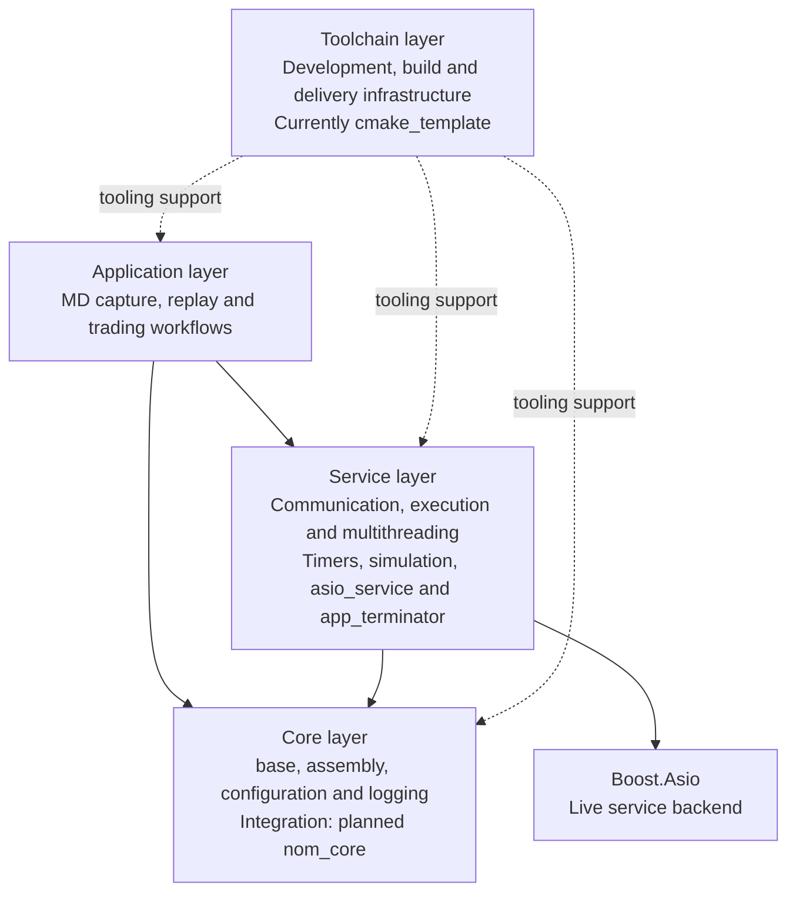

# Layers and integration boundaries

Updated 8 November 2026.

Nomisma separates development tooling, core libraries, reusable runtime services, and
applications. Each layer owns its components and the integration needed to use them together.
This document records the ownership boundaries; the roadmaps cover the
[toolchain](toolchain-layer.md), [core](core-layer.md), [service](service-layer.md), and
[application](application-layer.md) layers. Layer names describe responsibilities independently
of the repositories that implement them.

## Layer dependencies

Solid arrows mean **depends on**. Dashed arrows show **tooling support**, such as repository
setup, builds and validation. The diagram includes planned execution, multithreading, and
simulation facilities.



| Layer | Owns | Examples |
| --- | --- | --- |
| Toolchain | Repository setup, build and test infrastructure, development conventions, packaging, and shared-tool updates | Currently `cmake_template` and its synchronized kit |
| Core | Common definitions, component composition, configuration, logging, and adapters between them | Configuration types, assembly/relay, JSON mapping for logger configuration |
| Service | Reusable runtime facilities provided to applications and integration between those facilities | `asio_comm`, timers, execution engines, multithreading, simulation, `asio_service`, `app_terminator` |
| Application | Selection and composition of services, domain behavior, configuration values, and operational policy | Exchange subscriptions, capture output, replay inputs, and conditions for successful completion |

Library dependencies go toward lower layers. Core does not depend on service components or
Boost.Asio. Execution contracts belong to the service layer even when they are independent of
the backend. A simulation engine and scheduler therefore belong alongside the live runtime
services, with their own virtual-time implementation.

The toolchain layer supports all three code layers. `cmake_template` currently supplies this
infrastructure through the copied and synchronized kit; it is not a runtime dependency. The
layer can retain its name if that repository is replaced, split, or supplemented later.

## Repository layout

The workspace groups independent repositories under `core/`, `services/` and `toolchain/`.
The current toolchain implementation lives in `toolchain/cmake_template/`; `md_capture/`
remains at the workspace root. `research/` holds local investigations and source checkouts.
These directories organize the workspace; they do not merge the component repositories.

Inside every repository, reusable library sources belong in `src/<component>/`, regardless of
their architectural layer. Applications remain in `apps/<exchange>/<app>/` or `apps/<app>/`.
Documentation stays in `docs/<repo>/` and tools in `tools/<repo>/`, with no extra layer directories.
For example, workspace-relative source paths will be:

```text
core/base/src/base/
services/asio_comm/src/asio_comm/
md_capture/src/md_logger/
```

A repository can contain components from more than one layer; their responsibilities and
dependencies determine the layer. Module, target and public include names remain unchanged by
the source-directory rename. `nom_core` names the planned integrating repository, distinct from
the core layer and the workspace's `core/` directory.

Source paths in this handbook use the agreed `src/` convention. Migration of the template and
component source trees is pending; this documentation update does not relocate code.

## Core integration

The planned `nom_core` repository will combine `assembly`, `json_config`, and logging, using
`base` for shared definitions. It will own adapters between these components and select a tested
set of their versions. The component libraries retain their own repositories and APIs; they do
not depend back on the integrating `nom_core` repository.

The repository has not yet been created. The distinction between intended ownership and current
source locations matters for the following examples.

### Logger configuration and JSON/C++ mapping

There are three separate responsibilities:

| Responsibility | Owner | Definition (paths relative to the owner's repository) |
| --- | --- | --- |
| Configuration value types and presence policies | `base` | `nom.config_types`, including `cfg_defaulted`, `cfg_optional`, strings, and numeric types |
| Logger configuration structure, defaults, and validation | `spd_logger` | `log_level`, `logfile_config`, and `log_config` in `src/spd_logger/spd_logger.cppm`; validation in `src/spd_logger/log_config.cpp` |
| JSON/C++ mapping for those logger types | Planned `nom_core` adapter, using `json_config` | Enum-name mapping and member mappings defined with `NOM_JCONFIG_ENUM` and `NOM_JCONFIG` |

For example, `spd_logger` exports this C++ configuration in namespace `nom`:

```cpp
struct log_config
{
    cfg_defaulted<log_level> level{log_level::info};
    cfg_optional<logfile_config> file{};

    std::expected<void, std::string> validate() const;
};
```

`logfile_config` contains the filename and optional rotation size. The default log level is
`info`; an unset file selects console output. These definitions support direct C++ construction
and validation without a JSON dependency in `spd_logger`.

`json_config` supplies generic mapping machinery through `json_config/config.h` and
`nom.json_config`. The adapter imports the configuration and logging modules and defines the
logger mappings in namespace `nom`, alongside the types for argument-dependent lookup:

```cpp
NOM_JCONFIG(logfile_config, name, rotation_size)
NOM_JCONFIG(log_config, level, file)
```

The adapter also uses `NOM_JCONFIG_ENUM` for `log_level`. The current mapping accepts lowercase
and uppercase names, emits lowercase names, and rejects unknown values. The macros provide
the JSON conversions and configuration-type registration; the field wrappers retain their
defaulted and optional behavior.

This adapter currently lives in the `md_capture` working tree at
`apps/okx/okx_md_capture/log_config.h`. Its agreed destination is `nom_core`; the C++ types and
validation remain in `spd_logger`, and the generic mapping macros remain in `json_config`.

The application owns its `log` section and actual settings. The OKX application's
`app_config` contains `cfg_defaulted<nom::log_config> log`, includes that member in its own
`NOM_JCONFIG` mapping, and passes the loaded configuration to `nom::init_logger`. Moving the
adapter gives applications one shared logger mapping while preserving application ownership
of configuration values and startup.

## Services supplied to applications

`asio_service` and `app_terminator` both belong in the service layer. The `asio_comm` examples
define them in `apps/common_app_nodes.h`; `md_capture` has its own versions in
`apps/okx/okx_md_capture/asio_service.h` and `app_terminator.h`, both in namespace `nom`.
Their intended shared destination is the planned `nom_services` repository. The move into
that repository and the module boundaries are still future work.

### asio_service

`asio_service` is an assembly node whose `context_mixin` contributes a
`boost::asio::io_context` to the application's context. Other nodes use that context and its
executor for asynchronous operations. Assembly constructs the context before the nodes and
destroys it after them.

The node supplies the execution context; the application drives `io.run()`. It does not create
worker threads. Future service-layer facilities can provide thread management or a simulation
engine. Assembly itself remains responsible for composition and synchronous relay dispatch.

### app_terminator

`app_terminator` provides termination coordination. It contributes an optional exit code to the
assembly context, handles `SIGINT` and `SIGTERM`, observes completion/failure events, and uses a
timer for configured runtime limits. The `md_capture` version dispatches `app_stop` once and
handles `feed_event::stop_failed`, allowing a subsequent shutdown failure to change the exit
code to failure. The `asio_comm` examples still use `service_command::stop`.

Individual services perform their cleanup in their stop handlers. The current assembly places
`asio_service` before `app_terminator`, and the terminator before other stop handlers. This
makes the context available and lets the terminator forward stop requests to later nodes.
The application keeps the assembly alive while outstanding I/O callbacks finish.

The termination mechanism is a reusable service. The application supplies its configuration and
reports the events that express its outcome. Currently, `exit_after_sec`, `require_completion`,
and `feed_event` provide that connection: the timer starts on connection, and completion and
failure events determine the result. Those event and configuration interfaces can be reviewed
as the service is generalized; `app_terminator` remains a service supplied to the application.
