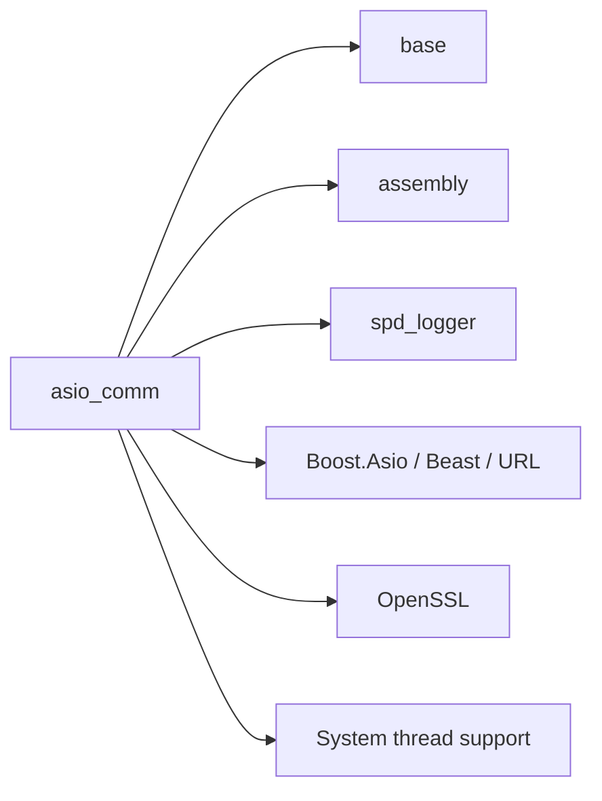

# Service layer: Communication and execution facilities

Updated 5 November 2026.

The [memorandum](../memorandum.md#architecture-directory) places reusable runtime services
above the [foundation layer](foundation-layer.md). Applications compose these services into
workflows described in the [application layer](application-layer.md). Component APIs, usage
constraints and validation evidence live with their code.

## Components and status

| Component | Responsibility | Status |
| --- | --- | --- |
| [asio_comm](https://github.com/nomisma-labs/asio_comm) | TLS WebSocket, HTTPS/HTTP/1.1 and timers based on Boost.Asio and Boost.Beast | Initial communication scope complete as of 5 November 2026; version 0.2.0 is prepared for release. |
| Multithreading facilities | Execution domains, worker lifecycle and explicit event transfer between threads | Future work; interfaces and repository boundaries remain to be designed. |

Additional services can join this layer as applications need them. The service layer does not
own trading strategies, exchange-specific subscription semantics or capture/storage policy.

## Communication: asio_comm

The `nom.asio_comm` module exposes three components:

- [`nom::web_socket`](https://github.com/nomisma-labs/asio_comm/blob/master/docs/asio_comm/web_socket.md):
  TLS WebSocket lifecycle and events, validated parameters, message limits, connection deadlines,
  automatic server-Ping replies and optional active/passive control-Ping monitoring.
- [`nom::https`](https://github.com/nomisma-labs/asio_comm/blob/master/docs/asio_comm/https.md):
  asynchronous HTTP/1.1 over verified TLS, bounded request queuing and connection/request/shutdown
  deadlines. One request/response exchange is active at a time.
- [`nom::timer`](https://github.com/nomisma-labs/asio_comm/blob/master/docs/asio_comm/timer.md):
  one-shot monotonic scheduling with generation-safe cancellation/rearming and move support.

Protocol state machines make completion, failure, cancellation and ownership transitions
explicit. Public client `close()` is silent and immediate. WebSocket sends currently block the
calling thread; HTTPS sends use the asynchronous queue. Calls and callbacks must be serialized
within the component's execution domain. The library does not create an application worker pool.

The library dependencies below are distinct from build tools and test fixtures:

The shared CMake kit comes from `cmake_template`; it is build infrastructure, not a runtime
component. Assembly/relay composes example applications and routes events synchronously.
Its routing does not schedule work or transfer ownership across threads.

The [examples](https://github.com/nomisma-labs/asio_comm/blob/master/apps/README.md) include
20 market-data feeders and 19 WebSocket/HTTPS symbol providers, with API references and
explicit Assembly/relay integration. These are integration examples, not complete capture
services. Exchange adapters own application heartbeats, subscriptions, payload interpretation
and useful-data freshness; an application owns reconnection and persistence policy.

The fresh `complete` build passed all 20 local tests, including source/installed consumers.
The [saved live check](https://github.com/nomisma-labs/asio_comm/blob/master/apps/conn_test_summary.md)
records 37 PASS, one empty one-second Crypto.com sample and one Binance SBE credential skip.
The runner now defaults to two seconds per feeder. These short checks do not establish
sustained availability, lossless capture, private-feed or order-execution readiness.

Remaining communication work is tracked in the repository's
[work plan](https://github.com/nomisma-labs/asio_comm/blob/master/core/asio_comm/current_work.md)
and [WebSocket stages](https://github.com/nomisma-labs/asio_comm/blob/master/core/asio_comm/ws_current_work.md):
long-running Ping/network-loss validation, close-timeout coverage, the exception audit,
HTTP sending enhancements and optional transport choices. The
[backlog](https://github.com/nomisma-labs/asio_comm/blob/master/TODO.md) also tracks future CI/CD
connectivity checks and a possible GitHub results dashboard.

## Future execution and multithreading services

Define execution-domain ownership, startup/shutdown and cross-thread event delivery before
adding worker facilities. Queued transfer needs owned data, ordering, backpressure and a clear
point at which callbacks have stopped. The existing synchronous relay does not supply those
guarantees by itself.

The communication repository contains an execution/simulation proposal covering engines,
executors, clock domains and replay. It remains a proposal; the current Asio-backed timer is
implemented, while backend-neutral execution and virtual time are future work. Keep those
contracts reusable across communication clients and applications rather than embedding them
in an exchange feeder.
